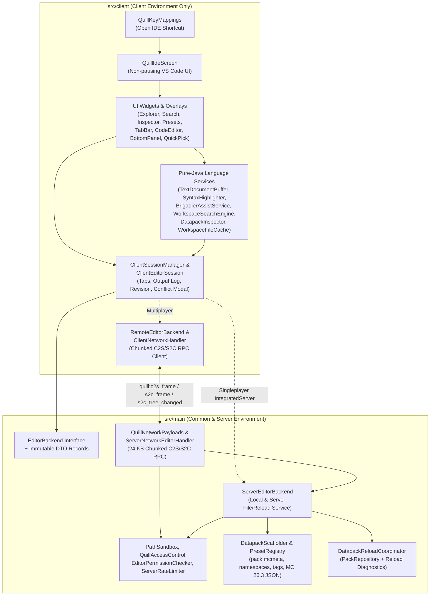
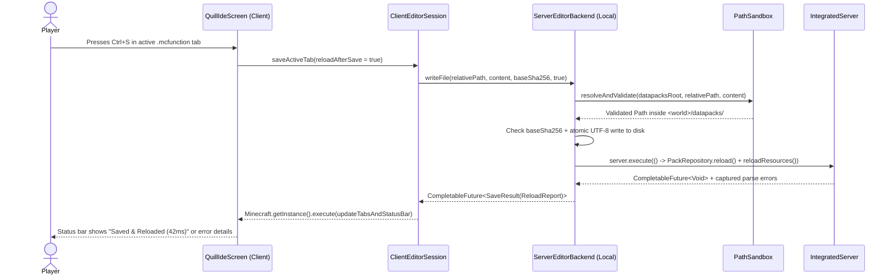
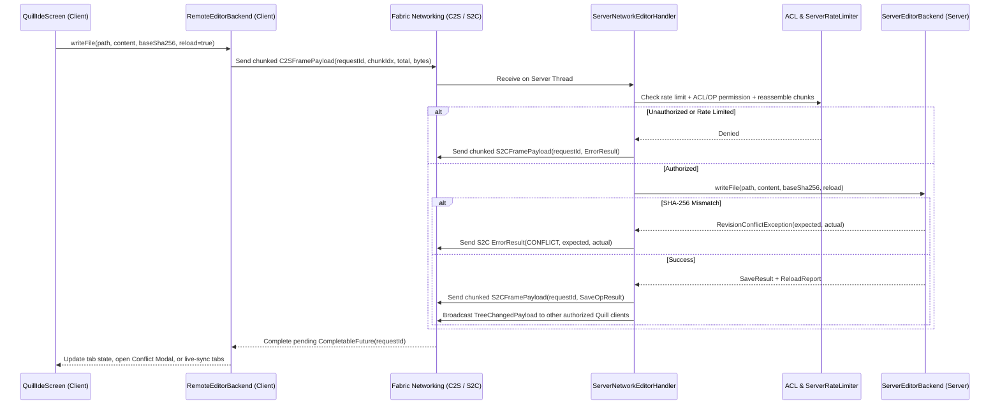

# Quill Architecture (ARCHITECTURE.md)

This document defines the module boundaries, client/server responsibilities, `EditorBackend` abstraction, data flows, and server security architecture for **Quill**.

For version and UI technology rationale, see [docs/DECISIONS.md](DECISIONS.md). For Minecraft `26.3` API specifics, see [docs/MC_NOTES.md](MC_NOTES.md).

---

## 1. Source Set & Module Boundaries

Quill uses Fabric Loom's `splitEnvironmentSourceSets()` to enforce a compile-time boundary between common/server logic (`src/main`) and client-only UI code (`src/client`).



### Package Layout

- **`src/main/java/dev/catgirlclaude/quill/`** (No imports from `net.minecraft.client.*` allowed):
  - `api/` — `EditorBackend` interface, request/response records (`FileTreeNode`, `FileDocument`, `SaveResult`, `ReloadReport`, `ReloadDiagnostic`, `PresetDescriptor`), and `RevisionConflictException`.
  - `backend/` — `ServerEditorBackend` (executes validated, per-root synchronized operations against a `MinecraftServer`'s `datapacks/` directory).
  - `security/` — `PathSandbox`, `QuillAccessControl` (`config/quill-acl.json`), `EditorPermissionChecker`, `ServerRateLimiter`, `EditorLimits`, `EditorSecurityException`.
  - `preset/` — `DatapackScaffolder` and `PresetRegistry` (loads built-in function-tag and MC `26.3` registry JSON templates under `src/main/resources/assets/quill/presets/`).
  - `reload/` — `DatapackReloadCoordinator` (triggers `PackRepository.reload()` + `MinecraftServer.reloadResources(...)` and captures function/JSON parse diagnostics).
  - `network/` — `QuillNetworkPayloads` (`quill:c2s_frame`, `quill:s2c_frame`, `quill:s2c_tree_changed`), `QuillRpcRequest`, `QuillRpcResponse`, `QuillProtocolCodec`, `ChunkedTransferAssembler`, and `ServerNetworkEditorHandler`.
- **`src/client/java/dev/catgirlclaude/quill/client/`**:
  - `config/` — `QuillClientConfig` (`config/quill-client.json`), `QuillColorPalette` (7 built-in VS Code themes), and `KeyShortcut` (configurable shortcut parsing, matching, and live recording).
  - `input/` — `QuillKeyMappings` (`KeyMappingHelper` registration, server capability check via `ClientNetworkHandler.isServerQuillAvailable()`, and tick listener).
  - `network/` — `RemoteEditorBackend` (chunked C2S/S2C RPC `EditorBackend` client) and `ClientNetworkHandler` (S2C receivers and disconnect cleanup).
  - `session/` — `ClientSessionManager`, `ClientEditorSession`, and `OpenTabState` (manages singleplayer/multiplayer sessions, open tabs, coalesced autosave/reload triggers, templated datapack creation, workspace revision counter, Problems/Output bottom-panel state, `/function` execution, optimistic concurrency conflict prompts, and live `TreeChangedPayload` synchronization).
  - `editor/` — Pure-Java editor and language services (headless-testable via JUnit): `TextDocumentBuffer`, `SingleLineTextInput`, `SyntaxHighlighter`, `BrigadierAssistService`, `FuzzyMatcher`, `WorkspaceFileCache`, `WorkspaceSearchEngine`, and `DatapackInspector`.
  - `gui/` — `QuillIdeScreen` (uniform whole-GUI `uiScale()` zoom & mouse unscaling), `IdeLayout` (movable/resizable floating bounds, splitters, breadcrumbs), `QuillTheme`, `QuillDraw` (font style & scaled rendering), `IdeModal`, and VS Code-styled widgets/overlays (`FileExplorerTreeWidget` with inline create/rename, `SearchSidebarWidget`, `InspectorSidebarWidget`, `QuickActionsAndPresetsWidget`, `EditorTabBarWidget`, `CodeEditorWidget`, `SettingsPanelWidget`, `BottomPanelWidget`, `QuickPickOverlay`, `ModalPromptOverlay`, `NewDatapackModal`).
  - `mixin/` — `FontTextureMixin` and `GlyphRenderStateMixin` (zero-cleared `quill:*` font atlases and `FilterMode.LINEAR` glyph sampling inside the IDE).

---

## 2. The `EditorBackend` Contract

Even in Singleplayer, the client UI **never** touches `java.nio.file.Files` or `MinecraftServer` directly. Every action goes through `EditorBackend`, which returns `CompletableFuture<T>` so that both local asynchronous I/O and multiplayer network round-trips share the exact same UI code path.

```java
public interface EditorBackend {
    CompletableFuture<FileTreeNode> listTree();

    CompletableFuture<FileDocument> readFile(String relativePath);

    default CompletableFuture<SaveResult> writeFile(String relativePath, String content, boolean reloadAfterSave) {
        return writeFile(relativePath, content, null, reloadAfterSave);
    }

    CompletableFuture<SaveResult> writeFile(
            String relativePath,
            String content,
            String expectedBaseSha256,
            boolean reloadAfterSave
    );

    CompletableFuture<Void> createEntry(String relativePath, EntryKind kind);

    CompletableFuture<Void> renameEntry(String sourceRelativePath, String targetRelativePath);

    CompletableFuture<Void> deleteEntry(String relativePath);

    CompletableFuture<String> createDatapack(String packName, String description);

    CompletableFuture<String> createNamespace(String packName, String namespace);

    CompletableFuture<String> createFunction(String packName, String namespace, String functionPath);

    CompletableFuture<List<PresetDescriptor>> listPresets();

    CompletableFuture<FileDocument> applyPreset(String packName, String presetId, Map<String, String> variables);

    CompletableFuture<ReloadReport> reloadDatapacks();
}
```

### Core Data Transfer Records (`dev.catgirlclaude.quill.api`)

- **`FileTreeNode(String name, String relativePath, EntryKind kind, List<FileTreeNode> children)`** — Represents `datapacks/` root, datapack folders, `data/<namespace>/...`, and editable files.
- **`FileDocument(String relativePath, String content, String sha256, long lastModifiedEpochMs)`** — UTF-8 text content with SHA-256 content hash used for optimistic concurrency conflict detection.
- **`ReloadReport(boolean success, long durationMs, int enabledPackCount, List<ReloadDiagnostic> diagnostics)`** — Result of datapack reload, including any function/JSON parse errors (`file`, `line`, `message`).
- **`RevisionConflictException`** — Checked/runtime signal thrown when `writeFile(..., expectedBaseSha256, ...)` detects that the server file's current SHA-256 hash differs from the client's loaded base hash.

---

## 3. Core Runtime Flows

### 3.1 Singleplayer Flow (Save + Live Reload)



### 3.2 Extensible Presets Flow (`data/minecraft` Tags & MC `26.3` JSON Registries)

1. Built-in presets are stored as data-driven templates inside the mod JAR under `src/main/resources/assets/quill/presets/`:
   - `index.json` — lists all 7 available preset descriptors (`id`, `displayName`, `description`, `targetRelativePathPattern`, `defaultVariables`).
   - **Function Tags**:
     - `templates/minecraft_load.json.tmpl` + `templates/namespace_load.mcfunction.tmpl` — creates/merges `data/minecraft/tags/function/load.json` and scaffolds `data/<namespace>/function/load.mcfunction`.
     - `templates/minecraft_tick.json.tmpl` + `templates/namespace_tick.mcfunction.tmpl` — creates/merges `data/minecraft/tags/function/tick.json` and scaffolds `data/<namespace>/function/tick.mcfunction`.
   - **MC `26.3` Registry JSON Templates** (see [docs/MC_NOTES.md](MC_NOTES.md) section 2.4 for verified schema rules):
     - `templates/recipe_shaped.json.tmpl` -> `data/<namespace>/recipe/<name>.json`
     - `templates/recipe_shapeless.json.tmpl` -> `data/<namespace>/recipe/<name>.json`
     - `templates/loot_table.json.tmpl` -> `data/<namespace>/loot_table/<name>.json`
     - `templates/advancement.json.tmpl` -> `data/<namespace>/advancement/<name>.json`
     - `templates/predicate.json.tmpl` -> `data/<namespace>/predicate/<name>.json`
2. When the user applies a preset in the UI, `EditorBackend.applyPreset(...)` validates `namespace` and resource `name` (`DatapackScaffolder.validateResourcePath`), merges `"values"` non-destructively for function-tag presets (never overwriting existing entries), writes the target JSON/function file safely inside `<world>/datapacks/`, and reloads datapacks.

---

## 4. Multiplayer Architecture (Phase 3)

In multiplayer, both the client and the dedicated server install Quill. When `Minecraft.getInstance().getSingleplayerServer() == null`, `QuillKeyMappings` verifies `ClientNetworkHandler.isServerQuillAvailable()` (`ClientPlayNetworking.canSend(C2SFramePayload.TYPE)`) and `ClientSessionManager` binds `ClientEditorSession` to a `RemoteEditorBackend`.



### Packet Protocol (`dev.catgirlclaude.quill.network`)

- Uses Minecraft `26.3`'s `CustomPacketPayload` and `StreamCodec<FriendlyByteBuf, T>` registered via Fabric's `PayloadTypeRegistry.serverboundPlay()` and `PayloadTypeRegistry.clientboundPlay()` (see [docs/MC_NOTES.md](MC_NOTES.md) section 4.6).
- **Three registered channels**:
  - `quill:c2s_frame` (`C2SFramePayload`) — chunked RPC request frame (`requestId`, `chunkIndex`, `totalChunks`, up to `24 KB` payload bytes).
  - `quill:s2c_frame` (`S2CFramePayload`) — chunked RPC response frame (`requestId`, `chunkIndex`, `totalChunks`, up to `24 KB` payload bytes).
  - `quill:s2c_tree_changed` (`TreeChangedPayload`) — lightweight broadcast (`actorName`, `changeKind`, `affectedPath`, `newSha256`) sent to other connected, authorized Quill players after mutations.
- **Chunked Framing & Correlation**: `QuillProtocolCodec` encodes/decodes versioned (`v1`) sealed `QuillRpcRequest` / `QuillRpcResponse` messages with strict per-field bounds. `ChunkedTransferAssembler` splits and reassembles payloads in `24 KB` chunks (safely below Minecraft `26.3`'s `32,767`-byte C2S custom payload cap) and rejects duplicate, out-of-range, oversized, or timed-out transfers. `RemoteEditorBackend` correlates every `requestId` to a timeout-bounded `CompletableFuture` (`30s`) and fails all pending futures cleanly on server disconnect.
- **Optimistic Concurrency & Live Sync**:
  - `ClientEditorSession` passes each open tab's last known `sha256` hash to `writeFile(...)`. If another editor modified the file on the server, the server returns `ErrorCode.CONFLICT` (`RevisionConflictException`), and `QuillIdeScreen` prompts the user with a 3-action modal (**Overwrite** force-save / **Reload** latest server version / **Cancel**).
  - When `TreeChangedPayload` arrives from another player, clean open tabs auto-reload from the server, dirty tabs show a non-destructive warning banner in the status bar, and deleted/renamed files update the file tree and open tab state accordingly.

---

## 5. Server-Side Security Model

All security validations in `dev.catgirlclaude.quill.security` run in both singleplayer and dedicated multiplayer servers so every backend call is hardened by default:

### 5.1 Authorization & Dedicated ACL (`EditorPermissionChecker` & `QuillAccessControl`)

- **Singleplayer Integrated Server**: Allowed for the local host player (`server.isSingleplayerOwner(player.nameAndId())`).
- **Dedicated Multiplayer Server**: Controlled by `config/quill-acl.json` (auto-created with safe defaults on `SERVER_STARTING` and hot-reloaded on file mtime change). Evaluation precedence:
  1. **Explicit Deny** (`deniedUuids` or case-insensitive `deniedNames`) — always denied, even for server operators.
  2. **Explicit Allow** (`allowedUuids` or case-insensitive `allowedNames`) — allowed without requiring operator status.
  3. **Operator Fallback** (`allowOperators: true`, default) — requires `Permissions.COMMANDS_GAMEMASTER` (operator level >= 2, matching vanilla `/reload` and `/function`).
  4. Otherwise denied (`ErrorCode.PERMISSION_DENIED`).
- Unauthorized players never receive filesystem error details or `TreeChangedPayload` broadcasts.

### 5.2 Rate Limiting & Reload Cooldown (`ServerRateLimiter`)

- **Per-Player Request Token Bucket**: Enforced on new `C2SFramePayload` requests (configurable via `rateLimitRequestsPerMinute` in `config/quill-acl.json`, default `120` req/min with burst `40`). Continuation chunks of an already-admitted transfer do not consume extra tokens.
- **Global Reload Cooldown**: Enforced across all players on `reloadDatapacks()` and `writeFile(..., reloadAfterSave = true)` (configurable via `reloadCooldownMs` in `config/quill-acl.json`, default `500 ms`). Exceeding either limit returns `ErrorCode.RATE_LIMITED` without blocking the server tick loop.

### 5.3 Path Traversal & Sandbox Isolation (`PathSandbox`)

All paths received by `EditorBackend` are relative strings (e.g., `my_pack/data/custom/function/test.mcfunction`). `PathSandbox` enforces:
1. **Root Anchoring**: Resolves the target against `Path root = server.getWorldPath(LevelResource.DATAPACK_DIR).toAbsolutePath().normalize()`.
2. **Normalization & Prefix Check**:
   - Rejects null bytes (`\0`), Windows drive letters (`C:`), leading slashes (`/`, `\`), or `..` path segments.
   - Computes `Path resolved = root.resolve(sanitizedRelativePath).normalize()` and verifies `resolved.startsWith(root)`.
3. **Symlink & Junction Rejection**:
   - Walks existing parent components from `root` to `resolved` using `Files.isSymbolicLink(p)` and `toRealPath(LinkOption.NOFOLLOW_LINKS)` to prevent symlink escapes outside `<world>/datapacks/`.
4. **Protected Root Guard**:
   - Forbids deleting or renaming the `datapacks/` root directory itself.
   - Forbids editing `.zip` archive datapacks directly.
5. **File Extension Allowlist**:
   - Only permits reading/writing text-based datapack files: `.mcfunction`, `.json`, `.mcmeta`, `.txt`, `.md` (rejects `.jar`, `.class`, `.sh`, `.bat`, `.exe`, `.dll`, `.so`).

### 5.4 Resource, Networking & Size Limits (`EditorLimits`)

| Limit | Default Value | Purpose |
| :--- | :--- | :--- |
| `MAX_FILE_SIZE_BYTES` | `512 KB` (`524,288` bytes) | Prevents memory exhaustion on server/client and fits cleanly within packet chunking limits. |
| `MAX_LINE_COUNT` | `10,000` lines | Keeps editor rendering and Brigadier parsing responsive. |
| `MAX_TREE_DEPTH` | `16` levels | Prevents recursive directory bombs when scanning `datapacks/`. |
| `MAX_TREE_ENTRIES` | `5,000` nodes | Caps directory listing payload size. |
| `MAX_PATH_LENGTH` | `255` chars | Prevents filesystem path-length errors across Linux/Windows. |
| `MAX_CHUNK_BYTES` | `24 KB` (`24,576` bytes) | Keeps every C2S/S2C frame well below MC `26.3`'s `32,767`-byte C2S custom payload cap. |
| `MAX_MESSAGE_BYTES` | `1 MB` (`1,048,576` bytes) | Caps total reassembled RPC request/response size. |
| `MAX_CONCURRENT_TRANSFERS_PER_PLAYER` | `4` transfers | Bounds in-flight chunked assemblies per player. |
| `MAX_PENDING_TRANSFER_BYTES_PER_PLAYER` | `2 MB` (`2,097,152` bytes) | Prevents incomplete-chunk memory exhaustion attacks. |
| `TRANSFER_TIMEOUT_MS` / `REQUEST_TIMEOUT_MS` | `30,000 ms` | Evicts stale incomplete transfers and times out stalled client RPCs. |
| `DEFAULT_REQUESTS_PER_MINUTE` / `BURST` | `120` / `40` | Per-player token bucket ceiling (overridable in `config/quill-acl.json`). |
| `RELOAD_COOLDOWN_MS` | `500 ms` (Multiplayer) | Prevents malicious or accidental `/reload` spam from freezing the server tick loop. |

### 5.5 Safe Atomic File Writes

- File writes are synchronized per `datapacks/` root, verify `expectedBaseSha256` against the current on-disk file hash, write to a sibling temporary file (`.<filename>.quill.tmp`) in the same directory, and perform `Files.move(tmp, target, StandardCopyOption.REPLACE_EXISTING, StandardCopyOption.ATOMIC_MOVE)` (with fallback to `REPLACE_EXISTING` if the filesystem does not support atomic move), ensuring concurrent edits or crashes never leave a half-written `.mcfunction` or `pack.mcmeta`.
