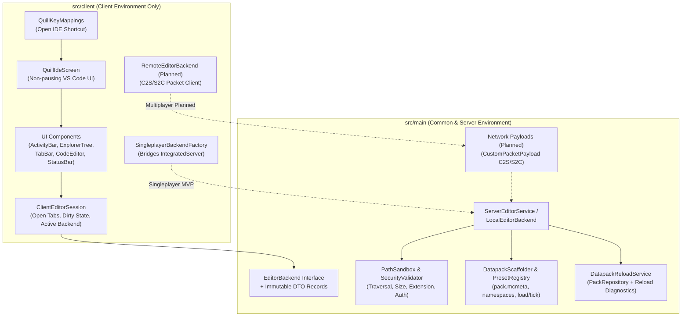
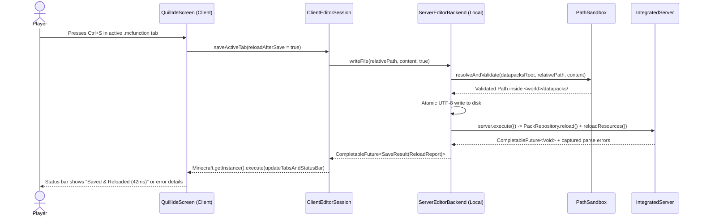
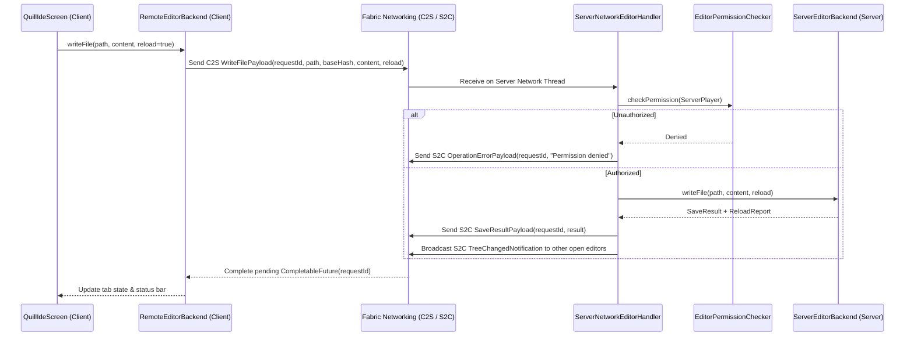

# Quill Architecture (ARCHITECTURE.md)

This document defines the module boundaries, client/server responsibilities, `EditorBackend` abstraction, data flows, and server security architecture for **Quill**.

For version and UI technology rationale, see [docs/DECISIONS.md](DECISIONS.md). For Minecraft `26.3` API specifics, see [docs/MC_NOTES.md](MC_NOTES.md).

---

## 1. Source Set & Module Boundaries

Quill uses Fabric Loom's `splitEnvironmentSourceSets()` to enforce a compile-time boundary between common/server logic (`src/main`) and client-only UI code (`src/client`).



### Package Layout

- **`src/main/java/dev/catgirlclaude/quill/`** (No imports from `net.minecraft.client.*` allowed):
  - `api/` — `EditorBackend` interface, request/response records (`FileTreeNode`, `FileDocument`, `SaveResult`, `ReloadReport`, `ReloadDiagnostic`, `PresetDescriptor`).
  - `backend/` — `ServerEditorBackend` (executes validated operations against a `MinecraftServer`'s `datapacks/` directory).
  - `security/` — `PathSandbox`, `EditorPermissionChecker`, `EditorLimits`.
  - `preset/` — `PresetRegistry` and loader for built-in preset templates under `src/main/resources/assets/quill/presets/`.
  - `reload/` — `DatapackReloadCoordinator` (triggers `PackRepository.reload()` + `MinecraftServer.reloadResources(...)` and captures function parse diagnostics).
  - `network/` *(Planned for Phase 3)* — C2S/S2C `CustomPacketPayload` definitions and server receivers.
- **`src/client/java/dev/catgirlclaude/quill/client/`**:
  - `input/` — `QuillKeyMappings` (`KeyMappingHelper` registration and tick listener).
  - `session/` — `ClientEditorSession` (manages open tabs, cursor state, undo history, status messages, and holds the active `EditorBackend` instance).
  - `gui/` — `QuillIdeScreen` and VS Code-styled widgets (`ActivityBarWidget`, `SidebarPanel`, `FileExplorerTreeWidget`, `EditorTabBarWidget`, `CodeEditorWidget`, `StatusBarWidget`, `ModalPromptOverlay`).

---

## 2. The `EditorBackend` Contract

Even in Singleplayer MVP, the client UI **never** touches `java.nio.file.Files` or `MinecraftServer` directly. Every action goes through `EditorBackend`, which returns `CompletableFuture<T>` so that both local asynchronous I/O and future network round-trips share the exact same UI code path.

```java
public interface EditorBackend {
    CompletableFuture<FileTreeNode> listTree();

    CompletableFuture<FileDocument> readFile(String relativePath);

    CompletableFuture<SaveResult> writeFile(String relativePath, String content, boolean reloadAfterSave);

    CompletableFuture<Void> createEntry(String relativePath, EntryKind kind);

    CompletableFuture<Void> renameEntry(String sourceRelativePath, String targetRelativePath);

    CompletableFuture<Void> deleteEntry(String relativePath);

    CompletableFuture<String> createDatapack(String packName, String description);

    CompletableFuture<String> createNamespace(String packName, String namespace);

    CompletableFuture<String> createFunction(String packName, String namespace, String functionPath);

    CompletableFuture<List<PresetDescriptor>> listPresets();

    CompletableFuture<FileDocument> applyPreset(String packName, String presetId, Map<String, String> variables);

    CompletableFuture<ReloadReport> reloadDatapacks();
}
```

### Core Data Transfer Records (`dev.catgirlclaude.quill.api`)

- **`FileTreeNode(String name, String relativePath, EntryKind kind, List<FileTreeNode> children)`** — Represents `datapacks/` root, datapack folders, `data/<namespace>/...`, and editable files.
- **`FileDocument(String relativePath, String content, String sha256, long lastModifiedEpochMs)`** — UTF-8 text content with content hash for conflict detection.
- **`ReloadReport(boolean success, long durationMs, int enabledPackCount, List<ReloadDiagnostic> diagnostics)`** — Result of datapack reload, including any function/JSON parse errors (`file`, `line`, `message`).

---

## 3. Core Runtime Flows

### 3.1 Singleplayer MVP Flow (Save + Live Reload)



### 3.2 Extensible Presets Flow (`data/minecraft`)

1. Built-in presets are stored as data-driven templates inside the mod JAR under `src/main/resources/assets/quill/presets/`:
   - `index.json` — lists available preset descriptors (`id`, `DisplayName`, `targetRelativePathPattern`, `defaultVariables`).
   - `templates/minecraft_load.json.tmpl` + `templates/namespace_load.mcfunction.tmpl` — creates/merges `data/minecraft/tags/function/load.json` and scaffolds `data/<namespace>/function/load.mcfunction`.
   - `templates/minecraft_tick.json.tmpl` + `templates/namespace_tick.mcfunction.tmpl` — creates/merges `data/minecraft/tags/function/tick.json` and scaffolds `data/<namespace>/function/tick.mcfunction`.
2. When the user selects a preset in the UI, `EditorBackend.applyPreset(...)` ensures the target datapack's `data/minecraft/tags/function/<tag>.json` exists (merging into the `"values"` array if the file already exists rather than overwriting existing entries!) and creates the corresponding `.mcfunction` file if missing.

---

## 4. Planned Multiplayer Architecture (Phase 3)

In multiplayer, both the client and the dedicated server install Quill. The client swaps `ServerEditorBackend` for `RemoteEditorBackend` when `Minecraft.getInstance().getSingleplayerServer() == null`.



### Planned Packet Protocol (`dev.catgirlclaude.quill.network`)

- Uses Minecraft `26.3`'s `CustomPacketPayload` and `StreamCodec` registered via Fabric's `PayloadTypeRegistry.playC2S()` and `PayloadTypeRegistry.playS2C()`.
- Every request carries a `long requestId` correlated by `RemoteEditorBackend` with a timeout-bounded `CompletableFuture`.
- Large files or trees exceeding 32 KB are split into chunked payloads (`ChunkedTransferPayload`) up to the configured server maximum.

---

## 5. Server-Side Security Model

Even in Singleplayer MVP, all security validations in `dev.catgirlclaude.quill.security` are active so the backend is hardened by design before networking is attached:

### 5.1 Authorization & Permissions (`EditorPermissionChecker`)

- **Dedicated Multiplayer Server**: Requires the requesting `ServerPlayer` to have **Operator Permission Level >= 2** (command block / function execution privilege, matching vanilla `/reload` and `/function` permissions) or an explicit entry in Quill's server allowlist.
- **Singleplayer Integrated Server**: Allowed for the local host player (`server.isSingleplayerOwner(...)` or integrated server host).

### 5.2 Path Traversal & Sandbox Isolation (`PathSandbox`)

All paths received by `EditorBackend` are relative strings (e.g., `my_pack/data/custom/function/test.mcfunction`). `PathSandbox` enforces:
1. **Root Anchoring**: Resolves the target against `Path root = server.getWorldPath(LevelResource.DATAPACK_DIR).toAbsolutePath().normalize()`.
2. **Normalization & Prefix Check**:
   - Rejects null bytes (`\0`), Windows drive letters (`C:`), leading slashes (`/`, `\`), or `..` path segments.
   - Computes `Path resolved = root.resolve(sanitizedRelativePath).normalize()` and verifies `resolved.startsWith(root)`.
3. **Symlink & Junction Rejection**:
   - Walks existing parent components from `root` to `resolved` using `Files.isSymbolicLink(p)` and `toRealPath(LinkOption.NOFOLLOW_LINKS)` to prevent symlink escapes outside `<world>/datapacks/`.
4. **Protected Root Guard**:
   - Forbids deleting or renaming the `datapacks/` root directory itself.
   - Forbids editing `.zip` archive datapacks directly (read-only notice or restricted to directory-based datapacks in MVP).
5. **File Extension Allowlist**:
   - Only permits reading/writing text-based datapack files: `.mcfunction`, `.json`, `.mcmeta`, `.txt`, `.md` (rejects `.jar`, `.class`, `.sh`, `.bat`, `.exe`, `.dll`, `.so`).

### 5.3 Resource & Size Limits (`EditorLimits`)

| Limit | Default Value | Purpose |
| :--- | :--- | :--- |
| `MAX_FILE_SIZE_BYTES` | `512 KB` (`524,288` bytes) | Prevents memory exhaustion on server/client and fits cleanly within packet chunking limits. |
| `MAX_LINE_COUNT` | `10,000` lines | Keeps editor rendering and Brigadier parsing responsive. |
| `MAX_TREE_DEPTH` | `16` levels | Prevents recursive directory bombs when scanning `datapacks/`. |
| `MAX_TREE_ENTRIES` | `5,000` nodes | Caps directory listing payload size. |
| `MAX_PATH_LENGTH` | `255` chars | Prevents filesystem path-length errors across Linux/Windows. |
| `RELOAD_COOLDOWN_MS` | `500 ms` (Multiplayer) | Prevents malicious or accidental `/reload` spam from freezing the server tick loop. |

### 5.4 Safe File Writes

- File writes write to a sibling temporary file (`.<filename>.quill.tmp`) in the same directory and perform `Files.move(tmp, target, StandardCopyOption.REPLACE_EXISTING, StandardCopyOption.ATOMIC_MOVE)` (with fallback to `REPLACE_EXISTING` if the filesystem does not support atomic move), ensuring a crash or power loss never leaves a half-written `.mcfunction` or `pack.mcmeta`.
